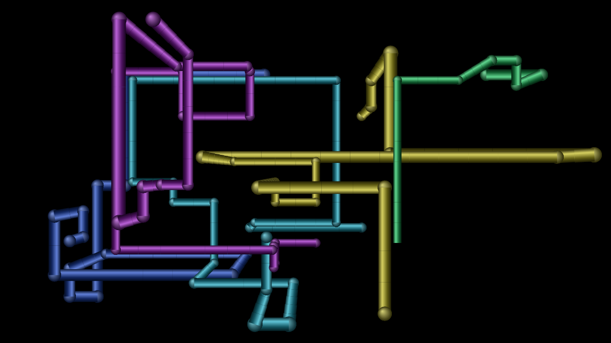
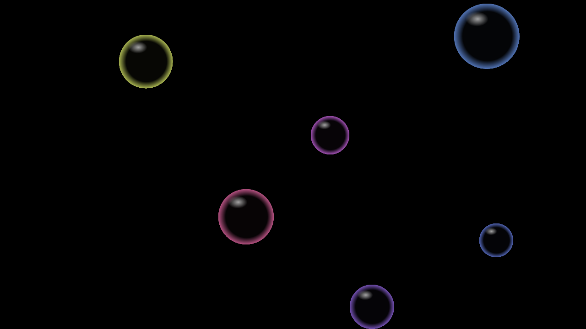
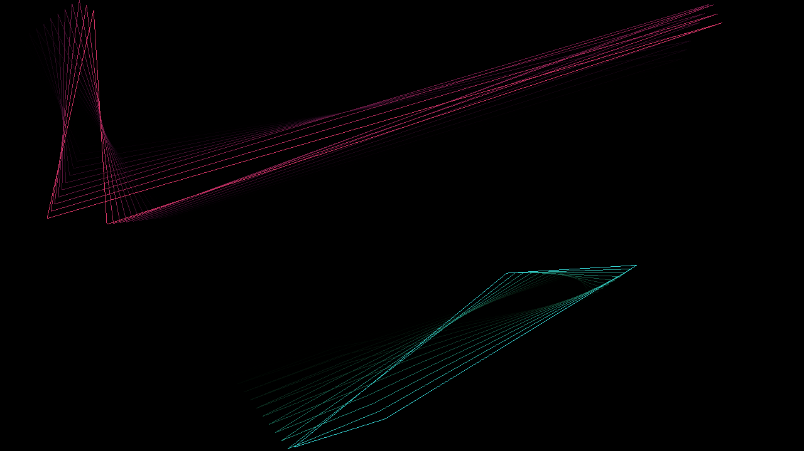
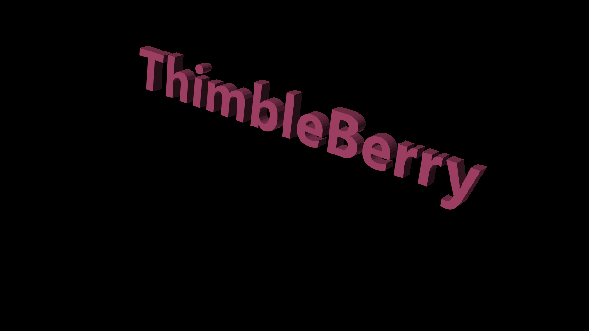
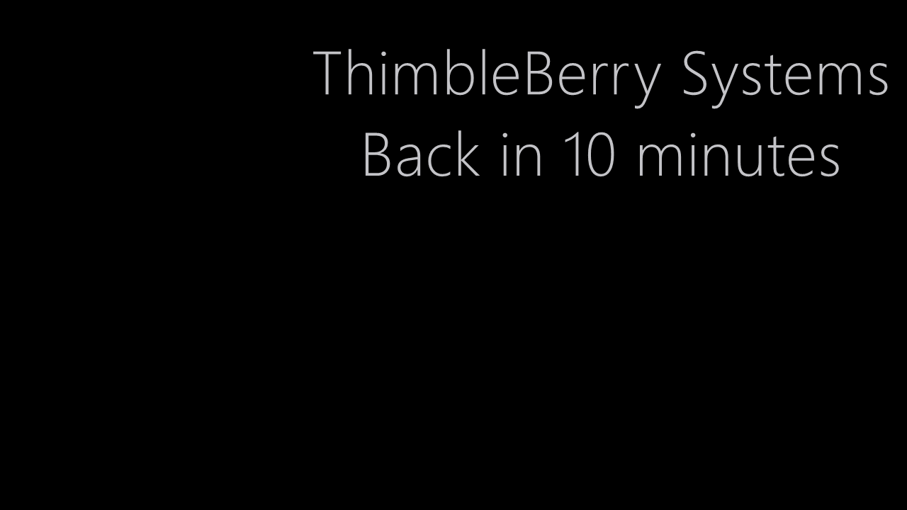
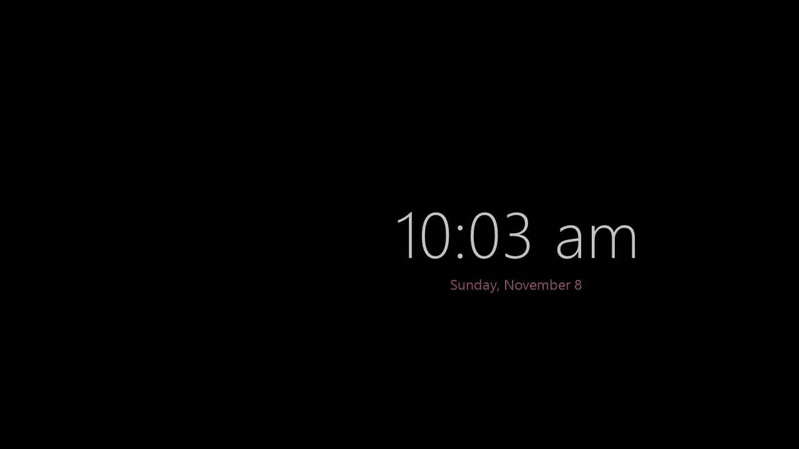
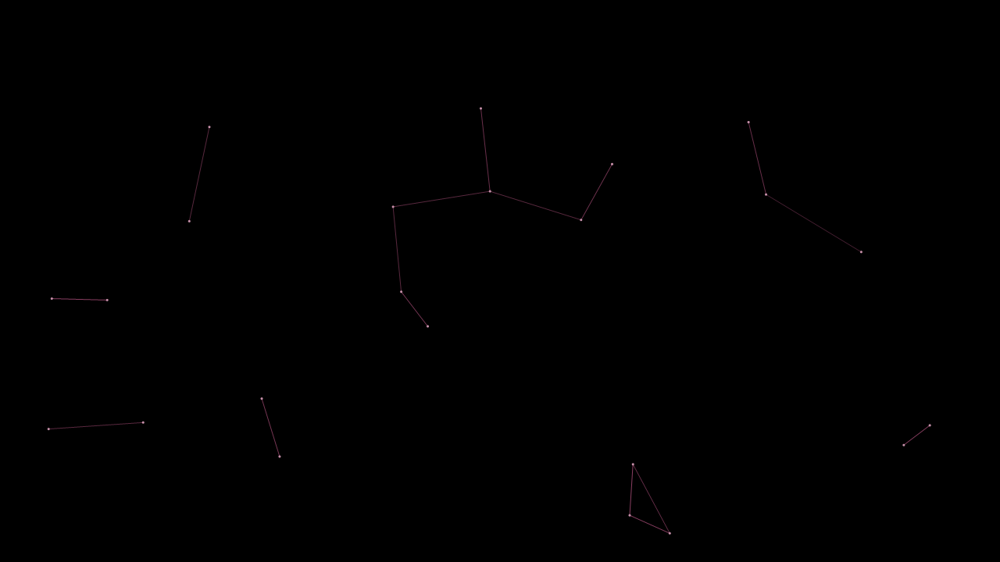
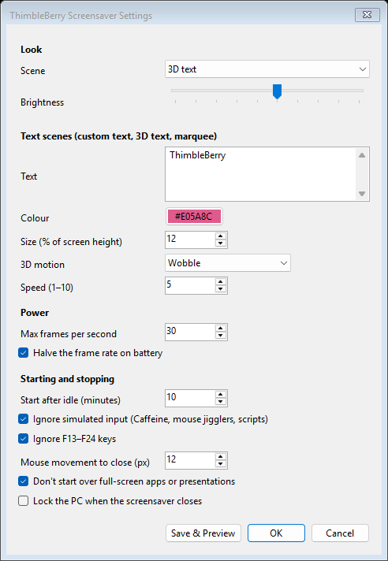

# ThimbleBerry Screensavers

Low-power Windows screensavers that still work while keep-awake tools such as
**Caffeine**, **PowerToys Awake**, mouse jigglers or presentation tools are running.


- **10 scenes:** ribbons, 3D pipes, bubbles, polygon trails, starfield, constellations,
  a drifting clock, and three for your own text (flat, rotating 3D and scrolling marquee)
- **Low power:** each scene uses under 5% of one CPU core at 1080p, and the clock and
  text scenes well under 1%
- **Works with keep-awake tools:** fake key presses and mouse moves are ignored
- **Easy install:** a per-user installer with no admin rights or .NET install needed

## Why keep-awake tools break normal screensavers

Windows starts a screensaver after its idle timer runs out. Keep-awake tools get in the way:

| Tool | What it does | Effect on a normal screensaver |
|---|---|---|
| Caffeine | Presses a fake **F15** key every ~59 s | Idle timer keeps resetting, so the screensaver never starts; if it was already showing, the key press closes it |
| Software mouse jigglers | Send tiny fake mouse moves | Same as above |
| PowerToys Awake and similar | Hold a Windows power request | Can stop the screensaver and display timeout |

This project fixes that in two ways:

1. **Idle watcher** (`ThimbleBerry.IdleWatcher.exe`), a tray app that counts only *real*
   keyboard and mouse input. Fake input carries an "injected" flag, so it's ignored, as
   are F13–F24 by default. After N minutes with no real input it starts the screensaver itself.
2. **The screensaver** (`ThimbleBerry.scr`) closes only on real input too, so Caffeine's
   F15 doesn't close it. The real key press that closes it is swallowed, so it doesn't
   also get typed into the app underneath.

## Low power by design

- Native Windows app with no browser engine. Frames are drawn on a timer and nothing runs in between.
- Each scene uses the lowest frame rate that still looks right: the clock and text draw
  **once a second**, most others 12–20 times a second. There's also a global FPS cap.
- Scenes that build up a picture (ribbons, pipes) draw only the new piece each frame;
  bubbles are drawn once and then just copied around.
- Frame rate halves on battery.
- Drawing stops while the display is off (for example after Windows turns the monitor off).
- Runs in Windows 11 **efficiency mode** (EcoQoS) at below-normal priority.
- Dark scenes with adjustable brightness: on OLED panels black pixels use almost no power.
- Content drifts slowly, so nothing burns into OLED or plasma screens.

## Scenes

<table>
  <tr>
    <td width="50%"><br><b>Ribbons</b> (default): twisting ribbons that wind across the screen</td>
    <td width="50%"><br><b>3D pipes</b>: shaded pipes growing through a 3D grid</td>
  </tr>
  <tr>
    <td><br><b>Bubbles</b>: glossy bubbles bouncing off each other</td>
    <td><br><b>Polygon trails</b>: bouncing outlines with fading trails</td>
  </tr>
  <tr>
    <td><br><b>3D text</b>: your text as solid letters that spin, seesaw, wobble or tumble while bouncing around the screen</td>
    <td><br><b>Marquee</b>: your text scrolling across the screen</td>
  </tr>
  <tr>
    <td><br><b>Custom text</b>: your message drifting slowly (lowest power)</td>
    <td><br><b>Drifting clock</b>: time and date drifting slowly (lowest power)</td>
  </tr>
  <tr>
    <td><br><b>Starfield</b>: a slow flight through sparse stars</td>
    <td><br><b>Constellations</b>: drifting points joined by faint lines</td>
  </tr>
</table>

Screenshots are taken at 85% brightness (the default is 60%). Regenerate them with
`dotnet run --project tools/Screenshots`.

CPU figures are measured at 1080p, for one monitor.

| Scene | FPS | CPU | Notes |
|---|---|---|---|
| Ribbons | 20 | ~2.3% | Twisting ribbons that wind across the screen, build up, then start over. **Default.** |
| Drifting clock | 1 | ~0.2% | Time and date that drift around the screen. Lowest power. |
| Custom text | 1 | ~0.1% | Your own message (multi-line, your colour and size), drifting slowly. Long text wraps and shrinks to fit. |
| 3D text | 20 | ~5% | Your custom text as solid, shaded 3D letters that spin, seesaw, wobble or tumble, bouncing around the screen |
| Marquee | 30 | ~3.4% | Your custom text scrolling across the screen, at a new height each pass |
| Starfield | 15 | ~0.9% | Slow flight through sparse stars |
| Constellations | 12 | ~2.5% | Drifting points joined by faint berry-coloured lines |
| Polygon trails | 20 | ~4% | Two bouncing outlines that leave fading, colour-shifting trails |
| Bubbles | 20 | ~3.7% | Glossy bubbles that drift and bounce off each other and the edges |
| 3D pipes | 20 | ~2.3% | Shaded pipes growing through a 3D grid with rounded joints, then starting over |

The classic-style scenes are original versions of familiar screensaver ideas, with no
Microsoft names, logos or assets.

## Install

### With the installer (recommended)

**[Download the latest installer from Releases](https://github.com/thimbleberrysystems/screensavers/releases/latest)**
(`ThimbleBerry-Screensavers-Setup-<version>.exe`).

It installs for the current user (no admin rights) and includes the .NET runtime, so
nothing else is needed. The installer isn't code-signed yet, so Windows may show "Windows
protected your PC": click **More info → Run anyway**. The wizard asks:

- whether to make ThimbleBerry your Windows screensaver
- whether to run the idle watcher, needed if you use Caffeine, PowerToys Awake or similar
- how many idle minutes before the screensaver starts

Uninstall from **Settings → Apps → Installed apps → ThimbleBerry Screensavers**.

To build the installer yourself (needs the .NET 10 SDK and Inno Setup 6,
`winget install JRSoftware.InnoSetup`):

```powershell
powershell -ExecutionPolicy Bypass -File .\scripts\build-installer.ps1
# -> artifacts\installer\ThimbleBerry-Screensavers-Setup-<version>.exe
```

### Releases are built automatically

GitHub Actions (`.github/workflows/build.yml`) builds the installer on every push and pull
request; download it from the run's **Artifacts**. To publish a release, push a version tag:

```powershell
git tag v0.2.0
git push origin v0.2.0
```

The workflow then creates a GitHub Release for that tag with the installer attached. Tags
with a suffix, such as `v0.2.0-beta`, are marked as pre-releases.

### From source with the scripts

Requires the [.NET 10 SDK](https://dotnet.microsoft.com/download) to build.

```powershell
.\scripts\install.ps1                 # 10-minute idle time
.\scripts\install.ps1 -IdleMinutes 5
.\scripts\install.ps1 -SelfContained  # bundles .NET so it runs on PCs without .NET 10
```

The install is per user and needs no admin rights. It:
- copies the files to `%LOCALAPPDATA%\ThimbleBerry\Screensavers`
- sets ThimbleBerry as your Windows screensaver
- starts the idle watcher now and at every sign-in

Uninstall with `.\scripts\uninstall.ps1`.

## Settings

Right-click the berry icon in the tray and choose **Settings…**, or open Windows **Screen
Saver Settings** and click **Settings**.



Settings are stored in `%APPDATA%\ThimbleBerry\Screensavers\settings.json`:

| Setting | Default | Meaning |
|---|---|---|
| `Scene` | `ribbons` | `clock`, `text`, `text3d`, `marquee`, `starfield`, `constellations`, `polygons`, `bubbles`, `ribbons` or `pipes` |
| `CustomText` | `ThimbleBerry` | Message for the custom text scene (up to 500 characters; line breaks kept) |
| `CustomTextColor` | `#E6E6EB` | Text colour as `#RRGGBB` |
| `CustomTextSize` | `12` | Text height as % of screen height (3–40) |
| `Text3DMotion` | `spin` | 3D text movement: `spin`, `seesaw`, `wobble` or `tumble` |
| `Text3DSpeed` | `5` | 3D text rotation and marquee scroll speed, 1 (slow) to 10 (fast) |
| `Text3DBounce` | `true` | Bounce the 3D text around the screen; `false` gives a slow drift instead |
| `Brightness` | `0.6` | 0.1 to 1.0 |
| `MaxFps` | `30` | Upper limit on frame rate (each scene uses its own lower rate, listed above) |
| `ReduceOnBattery` | `true` | Halve frame rate on battery |
| `IdleMinutes` | `10` | Minutes of real inactivity before starting |
| `IgnoreInjectedInput` | `true` | Ignore simulated input (Caffeine, jigglers, scripts) |
| `IgnoreF13ToF24` | `true` | Ignore F13–F24 even if they look physical |
| `MouseMoveThreshold` | `12` | Pixels the mouse must move to close the screensaver |
| `SkipWhenFullScreen` | `true` | Don't start over full-screen apps, games or presentations |
| `LockOnExit` | `false` | Lock the PC when the screensaver closes |

The tray menu also has **Start screensaver now** and **Pause for 1 hour**.

## Known limits

- **Hardware mouse jigglers** (USB devices) look like a real mouse and can't be detected.
- **Admin windows:** Windows hides input sent to elevated (admin) windows from the watcher.
  While one is in front, the watcher also uses Windows' own idle timer, so Caffeine can keep
  the screensaver from starting during that time. This is deliberate: better that than
  starting the screensaver while someone is typing in an admin terminal.
- **Locking:** if you want the PC to lock when the screensaver closes, turn on `LockOnExit`.
  Windows' own "On resume, display logon screen" only applies when Windows started the
  screensaver itself.

## Development

```powershell
dotnet build -c Release
.\src\Saver\bin\Release\net10.0-windows\ThimbleBerry.exe /s   # run full screen
.\src\Saver\bin\Release\net10.0-windows\ThimbleBerry.exe /c   # settings dialog
```

```
src/Shared   Input monitoring (real vs. fake input), settings, power helpers, Win32 interop
src/Saver    The .scr: /s full screen, /p preview, /c settings; scenes live in Scenes/
src/Watcher  Tray app that starts the screensaver after real inactivity
installer/   Inno Setup script for the Setup .exe
scripts/     install.ps1 / uninstall.ps1 / build-installer.ps1
tools/       Screenshots: renders every scene to docs/images for this README
```

To test the full-screen saver without it closing as soon as you touch the mouse, set
`THIMBLEBERRY_TEST_SECONDS`. It then ignores input and closes itself after that many
seconds (60 at most):

```powershell
$env:THIMBLEBERRY_TEST_SECONDS = 10; .\src\Saver\bin\Release\net10.0-windows\ThimbleBerry.exe /s
```

To add a scene, subclass `Scene` in `src/Saver/Scenes`, set `PreferredFps` as low as it
can go, then register it in `SceneFactory` and `SaverSettings.SceneIds`.
